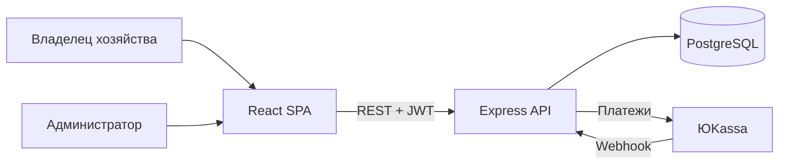

# FarmCRM — системный анализ и развитие SaaS-продукта

**Роман Бочаров · System Analysis / Product Development**

FarmCRM — веб-приложение для управления фермерскими хозяйствами: карточки животных, ветеринарные мероприятия, планирование ухода, производственный учёт, аптечка и подписки.

> Публичный кейс восстановлен по снимку исходников. **AS-IS** — поведение, обнаруженное при статическом анализе; **TO-BE** — предложения по развитию. Исходный код, клиентские данные и конфиденциальный технический аудит не публикуются. Работа развёрнутой системы и коммерческие результаты не проверялись.

## Бизнес-задача и моя роль

Объединить разрозненные операции хозяйства в одном рабочем пространстве: идентификацию животных, историю событий, планирование ухода, контроль продукции и медикаментов.

Моя роль: проработка требований, пользовательских сценариев, бизнес-логики, структуры данных и интеграций; участие в реализации, тестировании и запуске продукта. Артефакты портфолио оформлены ретроспективно.

| Масштаб реализации | Значение |
| --- | --- |
| Группы API-маршрутов / операции | 16 / 79 |
| Виды животных | 12 |
| Типы событий | 20 |
| Базовые тарифы | 3 |

## Навигация по кейсу

| Артефакт | Компетенции |
| --- | --- |
| [Продуктовая концепция](product/vision.md) | Сегменты, JTBD, ценность и монетизация |
| [Roadmap и метрики](product/roadmap-metrics.md) | Гипотезы, приоритеты, измеримость |
| [Требования и бизнес-правила](analysis/requirements.md) | Декомпозиция, трассировка |
| [Use cases](analysis/use-cases.md) | Основные и альтернативные потоки, критерии приёмки |
| [Архитектура](architecture/system.md) | REST, JWT, PostgreSQL, платёжная интеграция |
| [ER-модель](architecture/data-model.md) | Сущности, связи, ограничения |
| [Диаграммы](diagrams/README.md) | Sequence, activity, состояния |
| [OpenAPI](api/openapi.yaml) | Публичный фрагмент реконструированного контракта |
| [Тестовые сценарии](testing/test-cases.md) | Позитивные, негативные, конкурентные проверки |

## Архитектура

**Стек:** React 19, React Router, TanStack Query, Vite, Node.js, Express, PostgreSQL.

## Ключевые решения

- Уникальность основной бирки в пределах аккаунта.
- Разделение истории событий, медицинских записей и плановых напоминаний.
- Транзакционный перенос животных при удалении фермы.
- Контроль остатка медикаментов при списании.
- Защита от повторной активации оплаченной подписки.
- Тарифные ограничения количества ферм и карточек животных.

Фактические метрики использования, выручка и число клиентов не заявлены.

**Контакт:** [Telegram](https://t.me/romashbo) · [Профиль GitHub](https://github.com/Romashbo).
