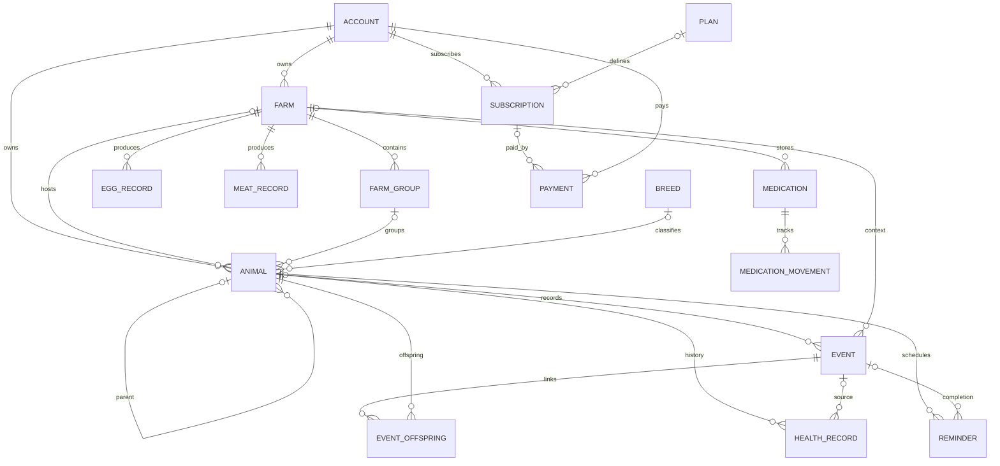

# ER-модель (AS-IS, логическое представление)

[К кейсу](../README.md)

Модель восстановлена из схемы и миграций. Названия сущностей обобщены для публичной презентации; диаграмма не заменяет точный DDL.

| Сущность | Назначение |
| --- | --- |
| Account | Владение данными, роль платформы |
| Farm / Farm group | Хозяйство и загоны |
| Animal / Breed | Карточка, бирки, порода, родители |
| Event / Health record | История операций и здоровья |
| Reminder | План, статус, связь с событием |
| Egg / Meat record | Производственные операции |
| Medication / Movement | Остаток и журнал изменений |
| Plan / Subscription / Payment | Монетизация и история оплат |

### Ключевые правила модели

- Основная бирка уникальна в аккаунте.
- Карточка содержит текущее местоположение, событие — исторический контекст.
- События и напоминания моделируют факт и план раздельно.
- Остатки и движения изменяются согласованно.
- Модель подписок сохраняет несколько записей на аккаунт; текущий план определяется бизнес-логикой.
