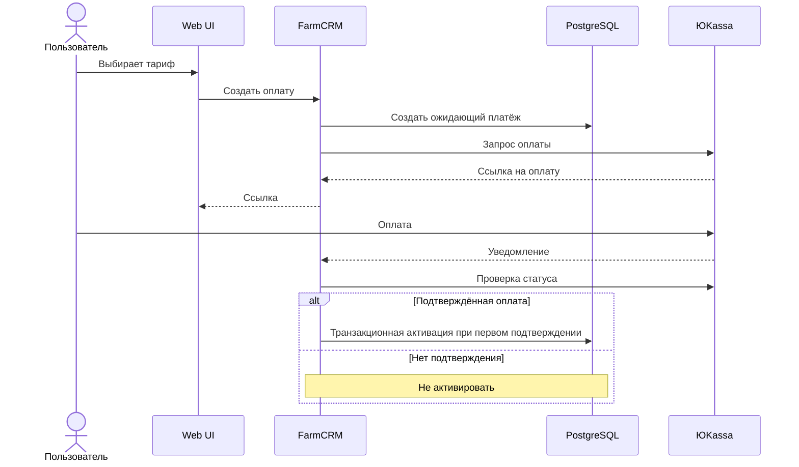
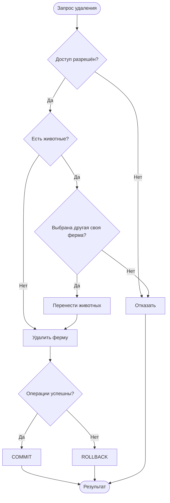
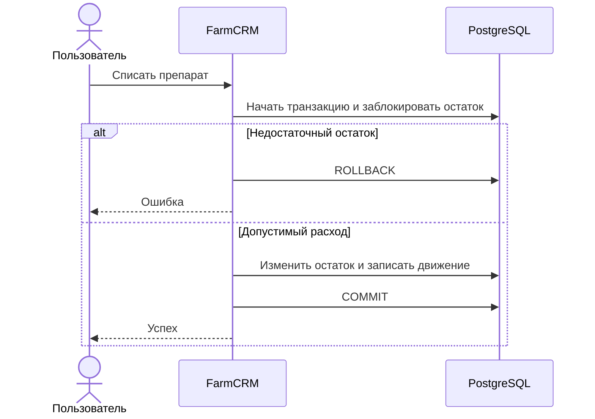
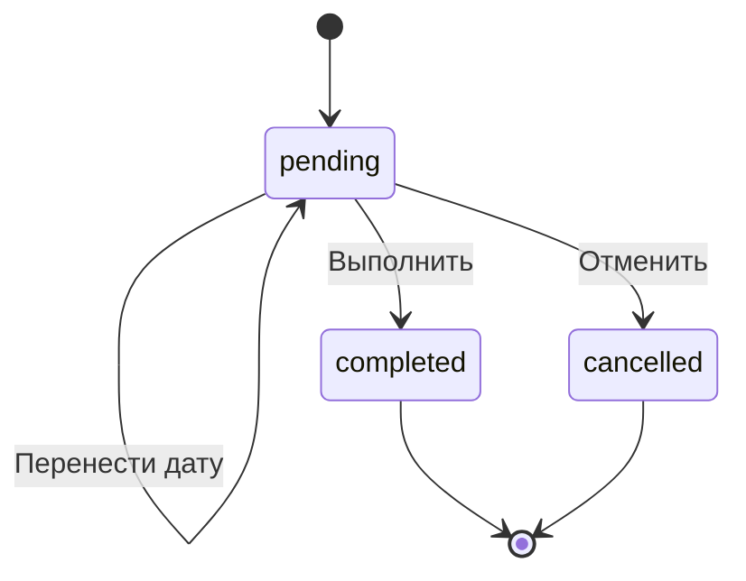
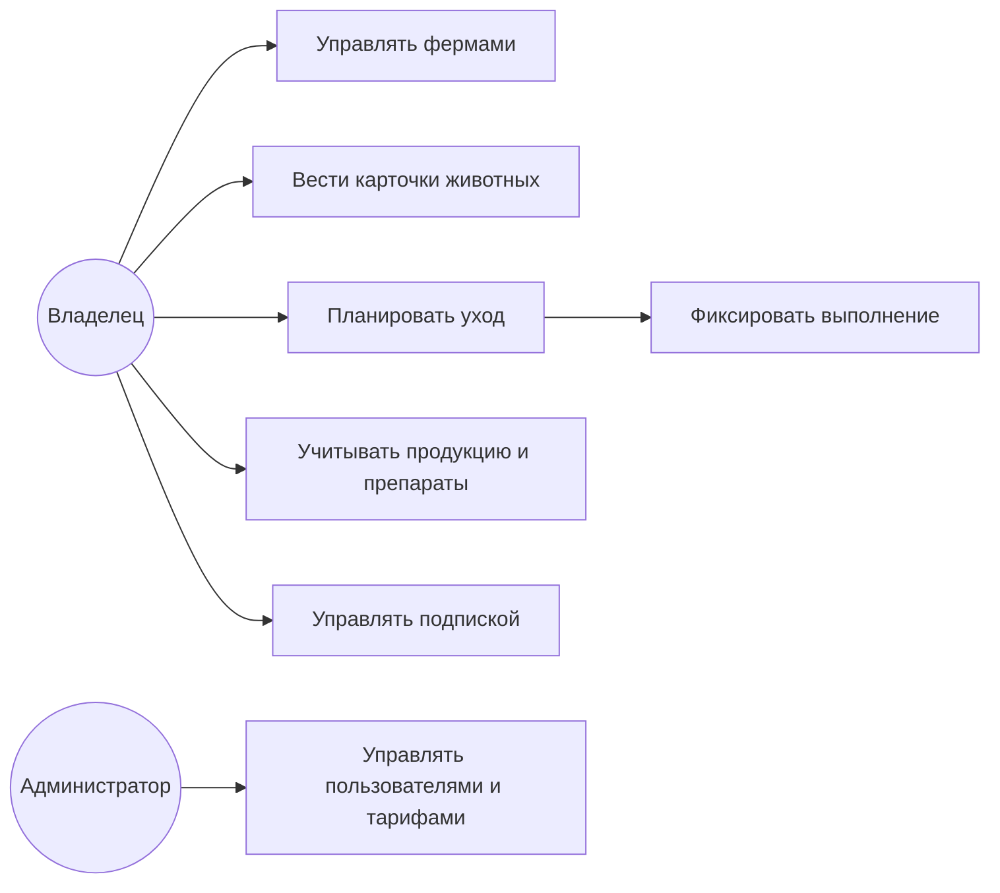

# Диаграммы процессов и взаимодействий

[К кейсу](../README.md) · [ER-модель](../architecture/data-model.md)

## Sequence — оплата подписки (AS-IS)

## Activity — удаление фермы (AS-IS)

## Sequence — движение медикамента (AS-IS)

## Состояния напоминания (TO-BE, предлагаемая модель)

Допустимость повторного открытия и судьбу связанного события следует согласовать. Это целевая модель, а не исчерпывающее описание текущего API.

## Карта возможностей

Диаграммы Mermaid — презентационные, не формальная BPMN-нотация.
